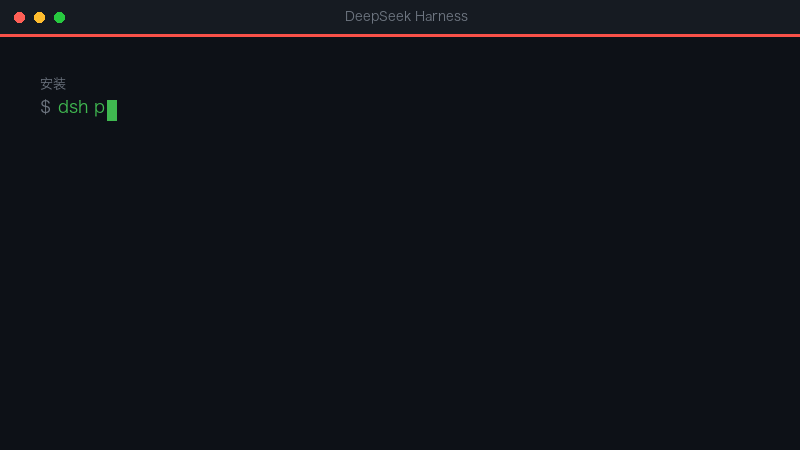
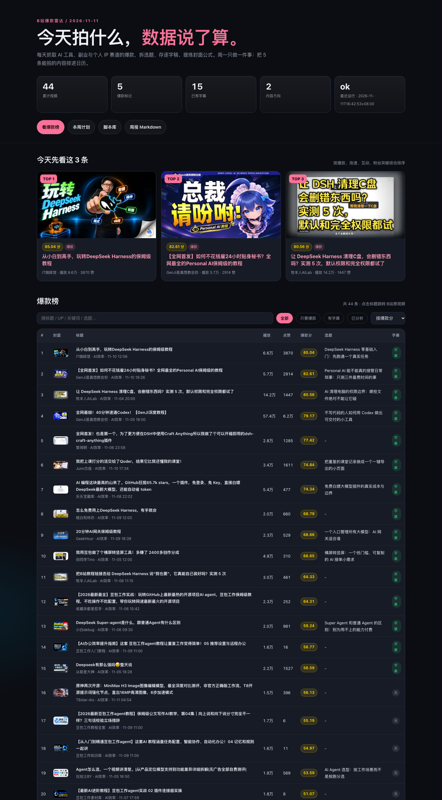

# B站爆款内容雷达 · dsh-bilibili-viral

> 🐧 **AI 学习群 1132348296** · niko 在这儿，插件我写、方向我找、坑我踩。 每周的爆款选题、封面模板、脚本写法，群里先发。



## 三大亮点

1. **不用自己刷榜** —— 每天自动抓 B站爆款，按播放、涨速、互动、粉丝突破综合打分，榜单直接摆在你面前。
2. **选题到封面一条龙** —— 每周给 5 条可拍选题、10 张 1280×720 封面、900–1800 字口播脚本；复刻原片结构，但逐句重写，8-gram 查重 <15%。
3. **全本地、不越界** —— cookie 只存本机，不下载整片、不做 ASR、不自动发布，发不发你说了算。

---

每天抓取 B站「AI 工具 / 效率实操 / 副业搞钱 / 个人 IP」赛道的爆款视频，拆解**标题、选题、封面、脚本**，每周生成 **5 条可拍内容 + 10 张封面 + 本地仪表盘**。

[](https://github.com/nekonya77/dsh-bilibili-viral/actions/workflows/ci.yml)



> 只做选题/脚本/封面/爆款榜，不做 MP4 合成、配音、自动发布。发布前请人工复核。

## 它解决什么

| 你的问题 | 这个工具的输出 |
|---|---|
| 今天 B站什么火？ | 近 2/7 天爆款榜，按播放、涨速、互动、粉丝突破综合评分 |
| 这条为什么火？ | 标题/钩子/结构/封面/观众情绪拆解 |
| 我这周拍什么？ | 每周 5 条“爆款复刻”选题，含标题候选、复刻说明、时间轴 |
| 脚本怎么写？ | 900-1800 字口播脚本，复刻原片结构但重写表达，8-gram 查重 |
| 封面怎么做？ | 5 种爆款风格，每条 2 版，1280x720 可直接用 |
| 怎么跟踪？ | 本地网页仪表盘 + 每日/每周 Markdown |

## 默认：爆款复刻模式

默认不要求你自己想创意。每周从近 7 天爆款里选 5 条**最可复刻**的，保留原片的：

- 选题与标题承诺
- 前 3 秒钩子
- 内容段落与信息密度
- 镜头/录屏顺序

必须替换/重写：

- 全部口播、字幕、举例、截图、口头禅
- 标题加“复刻版/实测/保姆级”等区分，不冒充原片
- 封面复刻公式，但不用原图；画面标注参考 BV
- 与任一竞品字幕 8-gram 重合 <15%

计划里每条会写 `clone_of`、`source_title`、`fidelity`；周报和仪表盘会显示“复刻自 BV”。原片里的收益/数据（如 2400、55 笔）只作为案例，不写成你的个人实测。

## 安装

### 方式 A：作为 DSH 插件安装

需要 DSH 和 `pnpm`：

```bash
dsh plugin --profile web add github:nekonya77/dsh-bilibili-viral
```

安装后技能 `bilibili-viral` 会出现在 DSH 的技能目录里。插件只负责注册技能；Python 运行环境仍需克隆仓库并 bootstrap：

```bash
git clone https://github.com/nekonya77/dsh-bilibili-viral.git ~/.bili-viral
cd ~/.bili-viral
bash scripts/bootstrap.sh
```

### 方式 B：本地克隆（推荐首次使用）

```bash
git clone https://github.com/nekonya77/dsh-bilibili-viral.git ~/.bili-viral
cd ~/.bili-viral
bash scripts/bootstrap.sh
```

`bootstrap.sh` 会创建 `.venv`、安装依赖并跑 `doctor`。也可以手动：

```bash
python3 -m venv .venv
.venv/bin/pip install -r requirements.txt
.venv/bin/python -m bili_viral doctor
```

环境要求：macOS，Python 3.9+，Chrome 已登录 [bilibili.com](https://www.bilibili.com)。

依赖：`curl_cffi`（B站请求）、`Pillow`（封面）、`PyYAML`、`Jinja2`、`markdown`、`yt-dlp`（读取 Chrome cookies）。

## 快速开始

```bash
export BILI_VIRAL_HOME="$HOME/.bili-viral"
cd "$BILI_VIRAL_HOME"

# 首次回填 7 天
.venv/bin/python -m bili_viral collect --days 7 --open

# 看仪表盘
open output/dashboard/index.html
```

首次约 3-8 分钟（受 B站限速和字幕数量影响）。如果 cookies 失败，先在 Chrome 登录 B站，再运行：

```bash
.venv/bin/python -m bili_viral collect --days 7 --refresh-cookies
```

## 每天 / 每周怎么用

### 每天 09:00（自动任务）

- 运行 `collect --days 2`
- 更新爆款榜、日报、仪表盘
- 把当天值得拆的视频放进 `data/analysis/<date>/top.json`

### 周一（生成 5 条）

1. 读 `data/analysis/<date>/top.json`、`transcripts.md`、`contact-sheet.jpg`
2. 写单条拆解到 `data/analysis/<date>.json`
3. 写周计划到 `data/plans/<week>.json`（5 条 idea，`mode=clone`，每条带 `clone_of`）
4. 写 5 份脚本到 `output/scripts/`（保留原片结构，逐句重写）
5. 写封面 spec 到 `data/cover_specs/<week>.json`
6. 运行：

```bash
python3 -m bili_viral validate
python3 -m bili_viral scriptcheck --week 2026-W47
python3 -m bili_viral cover --week 2026-W47
python3 -m bili_viral render --open
```

完整 agent 流程见 `skills/bilibili-viral/SKILL.md`。在 DSH 里直接说“跑一下 B站爆款雷达”或“复刻本周爆款/生成脚本封面”，会加载这个技能。

## 命令

```bash
python3 -m bili_viral doctor
python3 -m bili_viral collect --days 2
python3 -m bili_viral collect --days 7 --refresh-cookies --open
python3 -m bili_viral analyze-pack --top 20
python3 -m bili_viral validate
python3 -m bili_viral cover --week 2026-W47
python3 -m bili_viral scriptcheck --week 2026-W47
python3 -m bili_viral render --open
python3 -m bili_viral status
python3 -m bili_viral prune --days 90
```

`collect` 可选：`--no-transcripts`、`--no-covers`、`--no-report`、`--no-render`、`--no-pack`。

## 配置

改 `config.yaml` 后直接重跑，无需改代码。

| 配置 | 默认 | 说明 |
|---|---|---|
| `keywords` | 10 个 | `term` + `group` + `weight`；换赛道就改这里 |
| `filters.window_days` | 7 | 首次回填窗口 |
| `filters.daily_window_days` | 2 | 日常窗口 |
| `filters.min_play` | 10000 | 最低播放 |
| `filters.min_duration_s` | 60 | 最短时长（秒） |
| `filters.max_duration_s` | 2700 | 最长时长（秒） |
| `filters.block_categories` | 音乐/影视/游戏… | 排除分区 |
| `limits.max_transcripts` | 15 | 每次最多拉字幕条数 |
| `limits.max_covers` | 30 | 每次最多下载封面数 |
| `scoring.weights` | play .45 / velocity .25 / engagement .20 / breakout .10 | 爆款分权重 |
| `scoring.hot_score` | 75 | 爆款分阈值 |
| `scoring.hot_play` | 100000 | 播放阈值 |
| `cookies.browser` | chrome | 读取哪个浏览器的 B站登录 |
| `cover.size` | 1280x720 | 封面尺寸 |
| `schedule.daily_time` | 09:00 | 定时任务时间 |

### 换赛道

```yaml
keywords:
  - {term: "PPT 教程", group: "职场效率", weight: 1.0}
  - {term: "Excel 自动化", group: "职场效率", weight: 1.0}
```

再改 `filters.category_allow` / `block_categories`，跑 `collect --days 7`。

## 输出说明

### 爆款分

```
score = 100 × (0.45×播放百分位 + 0.25×涨速百分位 + 0.20×互动百分位 + 0.10×粉丝突破百分位)
        × 时长惩罚 × 新鲜度
```

- 涨速 = 播放 / 发布小时数
- 互动 = (点赞 + 2×收藏 + 2×投币 + 3×转发 + 评论 + 弹幕) / 播放
- 粉丝突破 = log(播放 / max(粉丝, 1000))
- `is_hot = score >= 75 或播放 >= 100000`

### 目录

```
config.yaml
bili_viral/                 代码
  bilibili.py               B站 API 客户端（限速/重试/缓存）
  cookies.py                Chrome cookie 读取与缓存
  rank.py                   过滤/相关度/爆款分
  transcripts.py            AI 字幕抓取与压缩
  covers.py                 封面下载/调色板/接触表
  covergen.py               5 风格封面生成
  analysis.py               agent JSON 校验/合并
  scriptcheck.py            脚本原创性/结构/合规
  report.py                 日报/周报/脚本 HTML
  render.py                 仪表盘
  cli.py                    命令行
  templates/                Jinja 模板
  assets/                   封面/脚本种子
skills/bilibili-viral/      DSH 技能与 3 份参考手册
lib/index.js                DSH bundle 入口
data/
  bili.db                   视频/UP/运行记录
  cookies/bilibili.json     B站 cookies（敏感，勿提交）
  cache/                    API 缓存
  analysis/                 agent 分析包与拆解
  plans/                    周计划 JSON
  cover_specs/              封面 spec
  transcripts/              AI 字幕 Markdown
  logs/                     运行日志
output/
  dashboard/index.html      仪表盘
  dashboard/data.json       仪表盘数据
  covers/library/           竞品封面 + 接触表
  covers/generated/<week>/  生成的封面
  scripts/                  脚本 Markdown + HTML
  daily/ weekly/            日报/周报
tests/                      unittest
```

## 数据与隐私

- 只抓公开数据：搜索、详情、UP 粉丝、AI 字幕、封面、评论。
- cookies 仅存本机 `data/cookies/bilibili.json`，不写入日志、不上传。
- 不下载完整视频；不做 ASR；不自动发布。
- 竞品字幕仅用于结构分析；脚本查重用 8-gram，重合 >15% 会报错。
- `data/`、`output/` 已加入 `.gitignore`，不会被提交。

## 自动更新与发布

```bash
# 每次迭代：测试 → 提交 → push
./scripts/ship.sh "feat: ..."

# 发版：测试 → 版本号 → tag → push，GitHub Actions 自动发 Release
./scripts/release.sh patch "feat: ..."
```

- `.github/workflows/ci.yml`：push/PR 跑 Python 单测、bundle 校验、`npm pack --dry-run`。
- `.github/workflows/release.yml`：tag 触发，打包并上传 `dsh-bilibili-viral.tgz`。
- 不监听文件自动 push，避免半成品和密钥入库。

## 故障排查

| 现象 | 处理 |
|---|---|
| `412` / HTML / 登录失效 | Chrome 登录 B站；`collect --refresh-cookies` |
| 字幕大量缺失 | 确认登录态；B站 AI 字幕不是每条都有，缺失会标 `missing`，不跑 ASR |
| 搜索 0 条 | 降 `min_play`、扩大 `window_days`、换关键词 |
| 封面下载失败 | 检查 `i0.hdslb.com` 网络；失败会用占位图 |
| `validate` 报字段缺失 | 按 SKILL.md 的 schema 补齐 |
| `scriptcheck` 重合 | 重写重合段落/换例子，不要只换同义词 |
| 仪表盘无图 | 确认 `output/covers/library/` 有图；路径是相对 `output/dashboard/` 的 `../covers` |
| 磁盘不足 | `prune --days 90`；清 `data/cache/`；保留 DB/脚本 |

## 测试

```bash
python3 -m unittest discover -s tests -v
node scripts/validate-bundle.mjs
```

## 设计边界

- 不做视频合成/配音/数字人：这些依赖大模型和素材，当前机器磁盘/内存不适合，也容易踩版权。
- 不做自动发布：B站发布需要人工确认标题/封面/分区/声明。
- 不保证爆款：工具只提高选题命中率，最终取决于执行、表达和迭代。
- 收益类内容必须标注“个人经历，不构成承诺”。

## 定时任务

首次运行成功后，在 DSH 里创建每天 09:00 的任务（`this_session`），提示词见 `skills/bilibili-viral/SKILL.md` 末尾。任务只做采集/分析/生成，不自动发布。

## License

[MIT](LICENSE)
